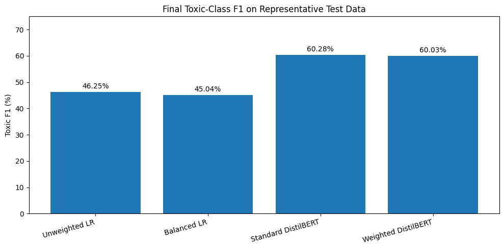
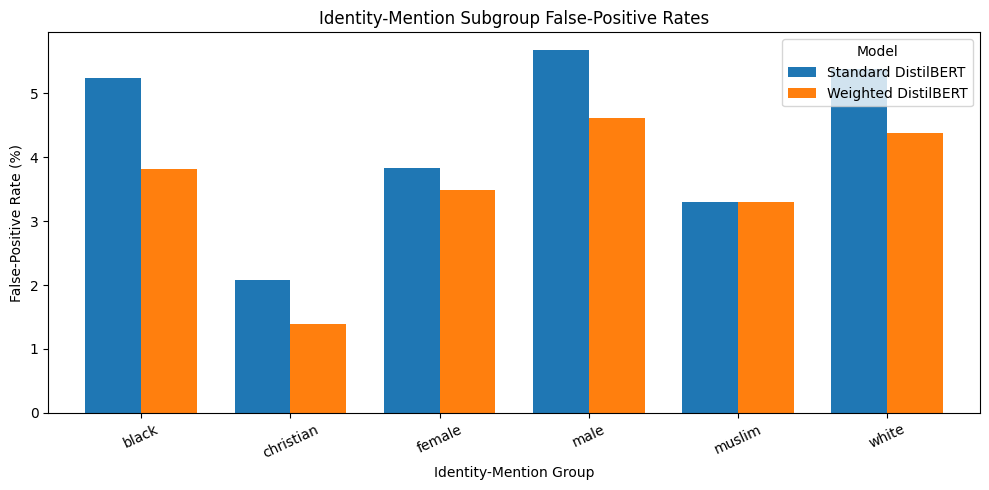
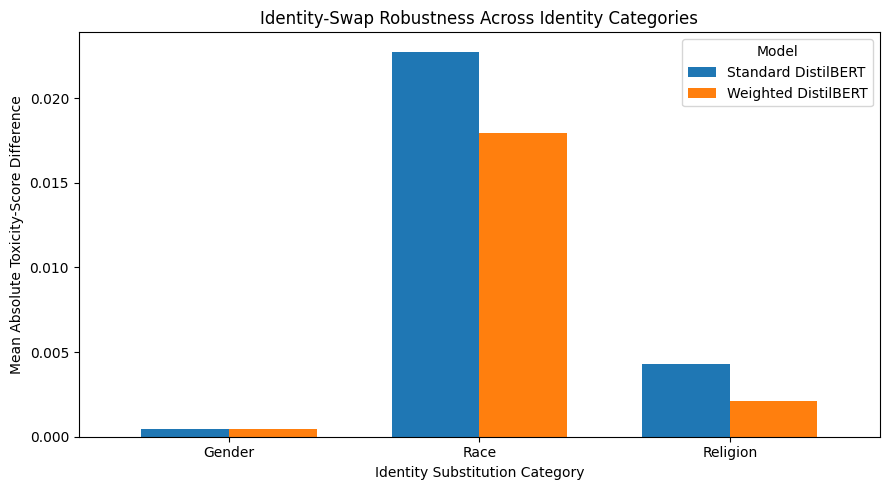

# Toxicity Detection: Fairness and Robustness Evaluation

An independent NLP research project comparing TF-IDF/Logistic Regression and DistilBERT for binary toxicity classification, with a **group-aware example-reweighting** intervention and subgroup/counterfactual robustness analyses.

## Research question

Can increasing the training importance of underrepresented identity–toxicity combinations reduce identity-related errors and sensitivity to controlled identity substitutions **without substantially degrading toxicity detection**?

This is an experimental, **single-seed** study. It does **not** establish that the weighted model is universally fairer.

## Main findings

**Held-out representative test (5,000 comments):**

| Model | Threshold | Toxic F1 | Toxic recall | ROC-AUC |
|---|---:|---:|---:|---:|
| Unweighted TF-IDF + Logistic Regression | 0.15 | 0.4625 | 0.4486 | 0.8493 |
| Balanced TF-IDF + Logistic Regression | 0.60 | 0.4504 | 0.3985 | 0.8496 |
| Standard DistilBERT | 0.25 | **0.6028** | **0.5840** | **0.9333** |
| Group-aware weighted DistilBERT | 0.30 | 0.6003 | 0.5815 | 0.9302 |

**Identity-enriched held-out test (3,000 comments):** the subgroup FPR gap across six identity-mention groups was 3.60 percentage points for standard DistilBERT and 3.22 percentage points for weighted DistilBERT. The paired-bootstrap 95% interval for the gap difference (weighted − standard) was **[−0.018862, 0.006745]** in rate units, which includes zero. Thus, improved subgroup FPR parity was **not statistically established**.

**Synthetic identity-swap robustness (144 pairs from 48 templates):** mean absolute toxicity-score sensitivity was 0.009168 (standard) versus 0.006832 (weighted), a **25.48% relative reduction**. The context-stratified, template-clustered bootstrap 95% interval for the difference (standard − weighted) was **[0.000983, 0.004191]**. This is evidence conditional on the constructed test templates, **not** proof of real-world demographic fairness.

Representative toxic-F1 difference (weighted − standard): **−0.002587**, paired-bootstrap 95% CI **[−0.015576, 0.009725]**.

## Figures







## Data and design

- Source: **Jigsaw Unintended Bias in Toxicity Classification** (original `train.csv` obtained from Kaggle).
- Original rows: **1,804,874**; cleaned unique comments: **1,780,226** after removing missing text, conflicting-label identical texts, and exact duplicates.
- Binary label: `target >= 0.5` is toxic.
- Training: **20,000**; validation: **5,000**; representative test: **5,000** (approximately 8% toxic in each).
- Additional identity-enriched test: **3,000** comments (1,800 non-toxic, 1,200 toxic), selected from unused data. This is **not prevalence-representative**.
- Identity mention annotations use available subgroup values `>= 0.5` for `male`, `female`, `christian`, `muslim`, `black`, `white`.
- No exact comment-text overlaps or ID overlaps across splits were reported in the notebook's checks.
- Final decision thresholds were chosen on **validation** only, then locked before test evaluation.

## Group-aware weighted model

The intervention assigns a raw weight to identity–label combinations based on their prevalence within the toxicity class:

`w(g,y) = clip(sqrt(0.10 / prevalence(g | y)), 1, 3)`

When a comment belongs to multiple selected identity groups, the maximum applicable weight is used. Weights are normalized to mean one. **1,714 / 20,000** training examples have greater relative weighting than the baseline examples. A custom `Trainer` computes per-example weighted cross-entropy, with gradient-accumulation-aware normalization.

**Important:** the model architecture remains `distilbert-base-uncased`; this project evaluates an experimental loss-weighting approach, not a newly invented transformer architecture.

## Repository layout

```text
.
├── README.md
├── notebooks/
│   └── Toxicity_Fairness_Research.ipynb
├── figures/
│   ├── representative_f1.png
│   ├── enriched_subgroup_fpr.png
│   └── identity_swap_robustness.png
├── results/
│   ├── final_model_metrics.csv
│   └── uncertainty_summary.csv
├── requirements.txt
└── .gitignore
```

## Reproducing the work

1. Open `notebooks/Toxicity_Fairness_Research.ipynb` in Google Colab.
2. Obtain the competition `train.csv` from Kaggle under its applicable terms and place it in your Google Drive, e.g. `MyDrive/AI Fairness Research/train.csv`.
3. Mount Google Drive, and update the `PROJECT_DIR` / `file_path` variables if using another folder.
4. Install the Python dependencies. The original session used **Transformers 5.22.2**, **Datasets 5.2.0**, **PyTorch 2.14.1+cu130**, and **Accelerate 1.15.0**; the environment is documented in the notebook. A GPU is recommended for fine-tuning.
5. Run the **relevant sequential experiment cells**, inspecting their outputs. This notebook is a chronological research log, including repeated setup, explorations, and revised cells; it has **not** been refactored or verified as a single `Run all` pipeline.

The dataset CSVs, fine-tuned model checkpoints, raw comments, cached artifacts, and full saved outputs are **not bundled** in this public package. Final aggregate metrics and three research figures are included for review.

## Limitations

- Each transformer configuration was trained under one reported seed; no multiple-seed stability study was completed.
- The weighted model has a **lower FPR in several subgroups**, but a **lower recall** on the enriched set, and its held-out subgroup FPR-gap difference was inconclusive under paired bootstrap.
- The synthetic robustness set contains constructed sentences and cannot establish population-level fairness.
- Identity annotations identify **mentions in comments**, not the demographic identities of their authors, and groups may overlap.
- The enriched dataset has a deliberately altered class distribution.
- Different models use their individually validated thresholds, so observed FPR changes cannot be attributed solely to the training weights.
- Model and dataset paths in the exploratory notebook assume a Google Drive layout; review paths before running.

## Responsible use and attribution

The project uses the Jigsaw dataset for research; obtain original data from its official distribution source and follow its terms. Do not commit raw comments, credentials, or downloaded model checkpoints without checking license, privacy, and repository size considerations.

## Status

Completed experimental study and analysis. The notebook is shared as an **exploratory research record** rather than a fully packaged training library or peer-reviewed publication.
